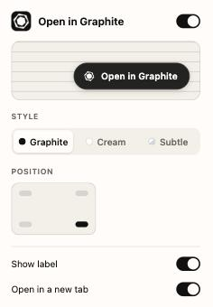

# Open in Graphite

A tiny Chrome extension that adds an **Open in Graphite** button to every GitHub pull request.

I got tired of swapping `github.com` → `graphite.com` in the address bar by hand, so now it's one click.


## Features

- Shows up only on PR pages (`/owner/repo/pull/123`, plus `/files`, `/commits`, etc.)
- Works with GitHub's in-app navigation, no reload needed
- Settings popup (click the extension icon):
  - Turn it on or off
  - Style: **Graphite** (black), **Cream**, or **Subtle** (matches GitHub, light and dark)
  - Position: any corner
  - Icon-only mode
  - Open in a new tab or the same tab
- Settings sync across your Chrome profile and apply instantly to open tabs



## Install

1. Clone this repo (or download the ZIP and unzip it):
   ```bash
   git clone https://github.com/NathenFernandes/open-in-graphite.git
   ```
2. Open `chrome://extensions` and turn on **Developer mode** (top right).
3. Click **Load unpacked** and select the `open-in-graphite` folder.
4. Open any GitHub PR. The button appears in the bottom-right corner.

Pin the extension from the puzzle-piece menu to get quick access to its settings.

## How it works

The content script matches `github.com/:owner/:repo/pull/:number` and links to
`graphite.com/:owner/:repo/pull/:number`. No network requests, no data collection.
The only permission is `storage`, for your settings.

## Not affiliated

This is a personal side project and isn't affiliated with or endorsed by Graphite.

## License

MIT
